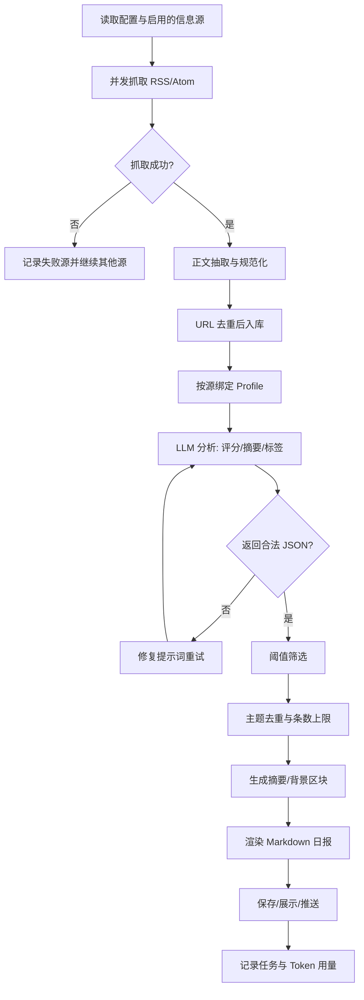
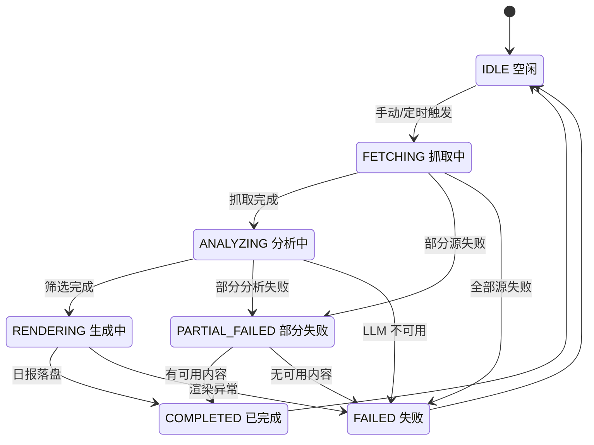
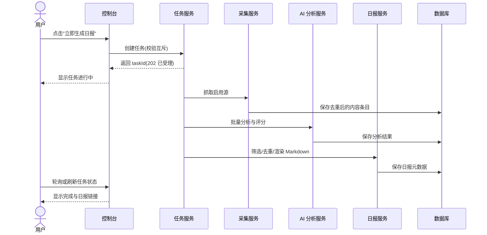
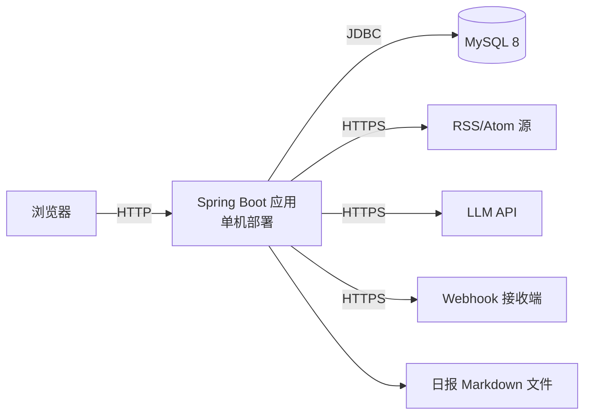

# 《可行性分析（研究）报告》与《软件需求规格说明》编写说明

> **适用项目**：基于 Spring AI 的 Horizon 类 AI 新闻聚合与日报生成平台（课程设计／毕业设计）
> **适用文档**：本工作区中的 `可行性分析_副本.doc`（FAR）与 `软件需求规格说明_副本.doc`（SRS）
> **本文性质**：只新增这一份说明，**不修改两份 .doc 原文件**；你按本文逐节把内容填进 Word 即可（需要我直接代填 .doc 时再另行说明）。
> **参考版本**：Horizon 仓库 `Thysrael/Horizon`（MIT 协议）克隆于 2026-10；Spring AI 版本信息核对到 2.0.1 / 1.1.8。

---

## 目录

1. [一页纸看懂怎么用](#1-一页纸看懂怎么用)
2. [项目定位与范围（两份文档的共同素材）](#2-项目定位与范围两份文档的共同素材)
3. [通用写作规范](#3-通用写作规范)
4. [FAR 逐章填写指南](#4-far-逐章填写指南)
5. [SRS 逐章填写指南](#5-srs-逐章填写指南)
6. [两份文档一致性检查清单](#6-两份文档一致性检查清单)
7. [可直接复用的图表代码（Mermaid）](#7-可直接复用的图表代码mermaid)
8. [答辩与查重提醒](#8-答辩与查重提醒)
9. [附录](#9-附录)

---

## 1. 一页纸看懂怎么用

### 1.1 两份文档一句话分工

| 文档 | 回答的问题 | 读者 | 课程里的作用 |
|---|---|---|---|
| 可行性分析（研究）报告（FAR） | **为什么做、值不值得做、用哪套方案做** | 决策者／指导老师 | 开题、立项依据 |
| 软件需求规格说明（SRS） | **做成什么样、做到什么程度、怎么验收** | 开发者／测试者／老师 | 设计、编码、测试、答辩验收的基线 |

> 一句话：**FAR 是"立项书"，SRS 是"合同"。FAR 里论证的方案，必须在 SRS 里落成可验收的需求；SRS 里写的东西，不能超出 FAR 论证过的范围。**

### 1.2 先做三件事（30 分钟）

1. **定项目名**：下文用 `【项目名】` 占位。工作区目录叫 `Sight`，建议就用 **Sight**（副标题：AI 新闻雷达与日报平台），这个名字与 Horizon（地平线）呼应，答辩时好解释。
2. **定范围**：先用 [2.4 范围裁剪表](#24-范围裁剪表目标蓝图-vs-本期实现) 勾出"本期实现（P1）"，这是整篇文档的地基。
3. **定基线**：确定 Spring Boot / Spring AI / JDK / 数据库版本（见 [2.7](#27-技术栈与版本基线)），全文两份文档只说这一套版本。

### 1.3 最重要的一条原则：文档写"完整平台"，验收写"P1 子集"

你们只实现一小部分功能，这**不丢分**，但写法要自洽：

- **FAR 第 5 章、SRS 3.3 写完整的平台蓝图**（模块划分、架构、扩展点），证明你们"想清楚了"；
- **SRS 3.4 能力需求用优先级 P1/P2/P3 分层**：只有 P1 是课程验收范围，P2 是"时间允许才做"，P3 是"规划，不在本期"；
- **在 FAR 5.5 局限性、SRS 6 尚未解决的问题里主动交代没做的部分**——主动写叫"范围管理"，被老师问出来叫"吹牛"。

> 反面写法（千万不要）：「本系统将支持 RSS、Hacker News、Reddit、X、Telegram、GitHub 等 10 类信息源，生成中英双语日报，支持邮件、微信、Webhook 推送……」
> 正面写法：「本系统面向个人使用，规划支持多种信息源；本期（课程周期内）实现 RSS/Atom 采集与 Hacker News 采集，其余源在架构上预留 Source 扩展点，列入后续版本。」

### 1.4 写作顺序建议（4 步，按此顺序做可减少返工）

1. **先写"需求范围清单"**（一张表：功能编号／名称／优先级／验证方式，见 [附录 B.2](#b2-需求清单可直接复制)）——不进文档，但两份文档都从它派生；
2. **写 FAR**：先写第 3、4、7 章（定前提、比方案、评技术风险），再回填第 1、2、5、6、8、9、10 章；
3. **写 SRS**：1、2 章 → 3.3 功能结构 → 3.4 能力需求 → 3.5 接口 → 质量／资源／算法 → 第 4、5 章；
4. **回填一致性**：交叉引用、编号、数字、名称，按 [第 6 章](#6-两份文档一致性检查清单) 逐项核对。

---

## 2. 项目定位与范围（两份文档的共同素材）

### 2.1 参考对象：Horizon 是什么

写文档前必须能用两句话准确说清参考项目（否则 4.1、5.3 会写空）。以下是按 Horizon 官方 README 与源码核实后的客观描述：

- **定位**：个人 AI 新闻雷达 / 日报生成工具（Python 实现，CLI 运行，MIT 协议）；
- **核心链路**：多源采集 → 正文抽取 → **Profile 驱动**的 AI 分析（0–10 评分、摘要、标签）→ 阈值筛选 → URL 去重＋AI 主题去重 → 内容区块增强（摘要／背景／影响／社区讨论）→ 按 Profile 分组渲染 Markdown 日报 → 发布分发（GitHub Pages／邮件／Webhook／微信）；
- **可借鉴的设计**：Profile（`profile.json` + 评分提示词 `analysis.md` + 匹配提示词 `match.md` + 增强提示词 `enrichment.md`）把"读什么、怎么评、写成什么样"全部配置化；这是它最有价值的部分；
- **工程外延**：定时任务（GitHub Actions）、Docker、MCP Server（把流水线各阶段暴露成工具）、Agent Skill；
- **内置 Profile 示例**：`tech-news`、`tech-blog`、`ai-creator`、`finance-news`。

> 引用方式：`[5] Thysrael/Horizon, GitHub, MIT License, https://github.com/Thysrael/Horizon`（写作时不要整段搬运 README，用自己话概括）。

### 2.2 本项目一句话定位（可直接改用到 FAR 1.2 / SRS 1.2）

> 【项目名】是一个基于 Spring AI 的 AI 新闻雷达与日报生成平台。系统从 RSS/Atom 等信息源采集内容，依据可配置的 Profile（评分规则 + 提示词模板）调用大模型完成筛选、评分与摘要生成，最终产出一份按主题分组、可直接阅读的 Markdown 日报，并支持定时运行与结果分发。

可选的三句话补充（用于 1.3 项目概述）：

1. 技术定位：Java 21 + Spring Boot + Spring AI 的 Web 应用（区别于 Horizon 的 Python CLI）；
2. 用户定位：需要每天快速获取技术资讯的个人用户（学生、开发者），单机／单用户部署；
3. 课程定位：软件工程课程设计的原型系统，重点验证"AI 内容筛选 + 可配置 Profile"的工程实现。

### 2.3 与 Horizon 的关系与差异（写进 FAR 4.2、5.3，答辩必问）

| 维度 | Horizon（参考对象） | 【项目名】（本项目） |
|---|---|---|
| 形态 | Python CLI + 静态日报站 + MCP Server | Java Web 平台（管理台 + REST API + 定时任务） |
| 技术栈 | Python 3 / uv / Pydantic / 多 LLM SDK | Java 21 / Spring Boot / Spring AI / MyBatis-Plus |
| 信息源 | 10 类（RSS、HN、Reddit、X、Telegram、GitHub、金融等） | RSS/Atom（≥2 个源）+ Hacker News（可选） |
| AI 能力 | 多 Profile 路由、评分、主题去重、内容区块（带搜索工具） | Profile 评分、阈值筛选、摘要＋背景区块（不接搜索工具） |
| 呈现 | 中英双语 Markdown 日报 | 中文 Markdown 日报 + Web 页面查看 |
| 分发 | Pages／邮件／Webhook／微信 | 页面查看 + 文件落盘 + Webhook（邮件为 P2） |
| 代码关系 | — | **独立实现，不复制其代码**；仅参考其"Profile 驱动"的设计思路 |

> 学术诚信写法（建议照抄进文档附录）：「本项目参考开源项目 Horizon 的 Profile 设计思想与处理链路划分，代码由团队独立实现，未直接复制其源码；Horizon 以 MIT 协议发布，其许可信息见引用文件。」

### 2.4 范围裁剪表：目标蓝图 vs 本期实现

这张表是**两份文档的公共底稿**：FAR 5.1／5.5 用它说明"做了什么、没做什么"，SRS 3.24 用它定义优先级，答辩时用它解释范围。

| 能力域 | Horizon 原版 | 本项目（课程实现） | 优先级 | 验收方式 |
|---|---|---|---|---|
| 信息源接入 | 10 类 | RSS/Atom（≥2 源，含 1 个真实技术博客源）；可选 Hacker News API | P1 | 演示＋测试 |
| 正文抽取 | trafilatura 全文提取 | jsoup 正文抽取（CSS 选择器规则 + 长度阈值） | P1 | 测试 |
| Profile 配置 | 4 内置 + 自定义（JSON＋3 套提示词） | 1 个内置 Profile（`profile.json` + 评分提示词 + 摘要提示词），支持新增配置 | P1 | 演示 |
| 内容路由 | 源显式指定 / AI 自动匹配 | 源显式绑定 Profile（AI 自动匹配列为 P3） | P1 | 测试 |
| AI 评分筛选 | 0–10 分 + 阈值 | 0–10 分 + 阈值（结构化输出 + 校验 + 重试） | P1 | 演示＋测试 |
| 去重 | URL 跨源去重 + AI 主题去重 | URL 规范化去重 + 主题去重（二选一实现：LLM 批量判定 或 Embedding 余弦相似度） | P1 | 测试 |
| 均衡日报 | 总条数上限 + 分类配额 | 总条数上限 | P2 | 测试 |
| 内容区块 | 摘要／背景／影响／社区讨论 + 搜索工具 | 摘要 + 背景（2 个区块） | P1 | 演示 |
| 双语日报 | 中英双语 | 中文（英文列为 P3） | P1 | 演示 |
| 分发 | Pages／邮件／Webhook／微信 | Web 页面 + Markdown 文件 + Webhook | P1 | 演示 |
| 定时运行 | CLI + GitHub Actions | 应用内 `@Scheduled`（如每日 08:00） | P1 | 演示＋审查 |
| 管理界面 | 无（改配置文件） | 简易 Web 控制台：源管理、立即生成、查看日报 | P1 | 演示 |
| MCP Server | 有（分阶段工具 + 资源） | 不做（作为 P3 扩展点） | P3 | — |
| 多用户／权限 | 无 | 不做（单用户，写明限制） | — | — |
| 移动端 | 无 | 不做 | — | — |

> 说明：P1＝课程验收必须实现；P2＝时间允许再做（实现或只留接口）；P3＝规划中、本期不实现（在 FAR 5.5、SRS 3.24 与第 6 章说明）。

### 2.5 最小可演示闭环（MVP，务必先跑通它）

```
1 个 RSS 源 → 抓取 → jsoup 正文抽取 → 按 Profile 调 LLM 评分（结构化输出）
→ 阈值筛选 → 摘要区块 → 渲染 Markdown 日报 → Web 页面查看 → 定时/手动触发记录
```

**验收演示脚本（答辩时按这个顺序演）**：

1. 打开控制台，添加一个 RSS 源（预置 3 个可选）；
2. 点击"立即生成"，展示任务状态从"抓取中"→"分析中"→"已完成"；
3. 打开日报页面，展示：按分数排序的条目、AI 摘要、原文链接、去重效果；
4. 展示任务记录（条数、token 用量、失败源）；
5. （可选）展示修改阈值后重新生成，结果条数变化。

> 能跑通这 5 步，P1 就达标了；文档里所有"能力需求""合格性规定"都围绕这 5 步写，不要发散。

### 2.6 Horizon → Spring AI 技术映射表（写 FAR 5.1 / SRS 3.3 用）

| Horizon 模块 | 职责 | 本项目对应实现 | Spring AI / Java 技术点 |
|---|---|---|---|
| `scrapers/` | 多源抓取 | `SourceFetcher` 接口 + `RssFetcher` | Spring `RestClient`／`WebClient` + ROME（RSS/Atom 解析） |
| `extractors/` | 正文提取 | `ContentExtractor`（jsoup） | jsoup；也可用 `spring-ai-jsoup-document-reader` 把 HTML 转成 `Document` 取文本 |
| `ai/client.py` | LLM 调用与多 provider | `AiClient` 封装 | Spring AI **ChatClient** + `spring-ai-starter-model-openai`（OpenAI 兼容）／`-deepseek`／`-ollama` |
| `ai/analyzer.py` | 评分、摘要、标签（JSON） | `AnalysisService` | ChatClient `.call().entity(AnalysisResult.class)`（**Structured Output**） |
| `ai/classifier.py` | Profile 路由 | 源配置直接绑定 Profile；AI 自动匹配列 P3 | Structured Output 或规则匹配 |
| `ai/enricher.py` | 内容区块（摘要/背景…） | `EnrichmentService` | 提示词模板（`PromptTemplate`）+ ChatClient |
| `orchestrator.py` | 流水线编排 | `DigestTaskService`（任务状态机） | Spring `@Scheduled` + 线程池／`@Async`；任务表记录状态 |
| 主题去重 | LLM 批量判定 | `DedupService` | 批量 Structured Output；或 **EmbeddingModel** + 余弦相似度 |
| `ai/summarizer.py` | 日报 Markdown 渲染 | `DigestRenderer` | 模板引擎（Thymeleaf/Freemarker）+ 文件存储 |
| `storage/` | 配置与产物存储 | `SourceRepository` 等 | MyBatis-Plus／Spring Data JPA + MySQL 8（开发期可用 H2/SQLite） |
| `services/email.py`、`webhook.py` | 分发 | `DeliveryService` | `JavaMailSender`、`RestClient` |
| `mcp/server.py` | MCP 工具 | 不做（P3） | 预留：`spring-ai-starter-mcp-server-webmvc` + `@Tool` |
| CLI | 命令行运行 | Web 控制台 / REST API | Spring MVC + 简单前端（Thymeleaf 或 Vue3） |
| 观察性 | 日志与统计 | 任务记录 + token 统计 | Spring Boot Actuator + Spring AI Observability（Micrometer） |

> **写文档时别把技术栈当卖点堆砌**：上表里真正需要在 SRS 3.4 写成"能力需求"的只有采集、抽取、分析、筛选去重、增强、日报、分发、调度、控制台九项；像"Spring AI Observability"这类只在 3.13 可维护性里提一句即可。

### 2.7 技术栈与版本基线

Spring AI 迭代很快（1.0 → 1.1 → 2.0），**文档里必须写死一套版本**，并说明理由：

| 方案 | 组合 | 适用场景 | 文档写法建议 |
|---|---|---|---|
| 稳妥型（推荐） | JDK 21 + Spring Boot 3.5.x + Spring AI 1.1.x（如 1.1.8）+ Spring AI BOM | 教程、博客、参考资料最多，兼容性好 | 「基线：Spring Boot 3.5.x、Spring AI 1.1.x」 |
| 最新型 | JDK 21 + Spring Boot 4.x + Spring AI 2.0.x（如 2.0.1） | 想展示新技术，但踩坑概率高 | 需在 FAR 7 风险里写明版本迁移风险 |
| 不建议 | Spring AI 1.0.0-M6 等里程碑版本 | 旧教程常见 | 不建议作为最终基线；若实验环境只能用它，写明"锁定里程碑版本及原因" |

其他技术选型建议：

- 构建：Maven（与现有练习项目一致）或 Gradle 均可，文档写清即可；
- 数据库：MySQL 8（课程验收用）；开发期可用 H2 降低环境依赖——两者切换能力写进 SRS 3.13 可移植性；
- 前端：Thymeleaf 服务端渲染最省事；Vue3 加分但增加工作量；
- 模型接入：**OpenAI 兼容协议**（DeepSeek／通义／Ollama 本地模型均可），文档里写成"可配置的 OpenAI 兼容 LLM 服务"，而不是写死某一家；
- 不要为了显得高级而写 RAG／向量数据库／Agent 编排——**没实现就别写**，否则答辩必被追问（见 [8.1](#81-答辩预测问题与回答要点)）。

版本相关的两个实用提醒：

1. Starter 坐标在 1.0 GA 后改过名：旧教程里的 `spring-ai-openai-spring-boot-starter` 对应新坐标 `spring-ai-starter-model-openai`；写技术方案时按新坐标写，免得老师按文档复现失败。
2. 文档中"可引用的技术能力"要写你能说清楚的：ChatClient、Structured Output（`.entity()`）、提示词模板、重试、多 provider 切换、`@Tool` 工具调用；**别写**"智能体自主规划"这类你没做的东西。

### 2.8 术语表（全文统一，直接放 SRS 第 7 章注解）

| 中文 | 英文／缩写 | 本项目含义 | 统一写法 |
|---|---|---|---|
| 信息源 | Source | RSS/Atom 订阅地址或 HN 接口 | 首次出现写"信息源（Source）"，之后统一用"信息源" |
| 内容条目 | Item / ContentItem | 从信息源抓到的一条内容 | 统一"内容条目" |
| 处理配置 | Profile | 一套"评分规则 + 提示词模板 + 呈现格式"的配置 | **保留英文 Profile 不翻译**，首次出现写"Profile（处理配置）" |
| 评分 | Score | LLM 按规则给出的 0–10 分 | "评分" |
| 阈值 | Threshold | 入选日报的最低分 | "阈值" |
| 去重 | Deduplication | URL 去重 + 主题去重 | 分开写"URL 去重""主题去重" |
| 内容区块 | Block | 摘要、背景等日报段落 | "内容区块" |
| 日报 | Digest | 最终生成的 Markdown 日报 | "日报" |
| 分发 | Delivery | Webhook／邮件等推送 | "分发" |
| 大模型 | LLM | 通过 API 调用的生成式模型 | 统一"大模型（LLM）" |
| 结构化输出 | Structured Output | LLM 按 JSON Schema 返回可映射对象 | "结构化输出" |
| 提示词 | Prompt | 发给 LLM 的指令文本 | "提示词（Prompt）" |
| 扩展点 | Extension Point | 预留的可插拔位置 | "扩展点" |

> 术语不一致是课程文档最常见的扣分点之一：同一份文档里不要出现"新闻源／信息源／订阅源"三种叫法。

---

## 3. 通用写作规范

### 3.1 标识与版本（两份文档必须一致）

模板 1.1"标识"一节别空着，建议直接套表格：

| 项 | 内容 |
|---|---|
| 项目名称 | 【项目名】（AI 新闻雷达与日报平台） |
| 文档名称 | 可行性分析（研究）报告 / 软件需求规格说明 |
| 文档编号 | `【项目英文名】-FAR-001` / `【项目英文名】-SRS-001`（例：`SIGHT-FAR-001`） |
| 版本号 | V1.0（每次修改升 V1.1，并写修订记录） |
| 密级 | 内部公开（课程设计成果，默认公开） |
| 编写人／日期 | 【姓名】【2026-XX-XX】 |

实用提醒：

- 两份 .doc 文件名带"_副本"，最终提交前按学校要求重命名（如 `SIGHT-FAR-001_可行性分析报告_V1.0.doc`）；
- 文档编号、项目名、版本、日期在两份文档里**逐字一致**；
- 若学校要求 .docx，另存为 .docx 后再排版，本说明不涉及。

### 3.2 需求编号与优先级规则

| 类型 | 前缀 | 示例 | 说明 |
|---|---|---|---|
| 功能需求（能力） | `FR-` 或 `C-` | `C-04`、`FR-04` | 全文用同一种，建议 `C-xx` 对应模板 3.4.x |
| 非功能需求 | `NFR-<属性>-` | `NFR-PERF-01` | 性能/可靠性/易用性/可维护性/可移植性/安全性/容量 |
| 外部接口 | `IF-` | `IF-03` | 对应模板 3.5.x |
| 数据 | `DR-` | `DR-02` | 对应模板 3.7／3.15 |
| 测试用例 | `TC-` | `TC-C04-01` | 对应模板第 4 章合格性规定 |
| 目标 | `G-` | `G-01` | FAR 3.2／SRS 3.2.1 共用 |

优先级只用三档，且全文口径一致：**P1＝课程验收必须实现；P2＝时间允许再做；P3＝规划、本期不做**。

### 3.3 可验证的写法（好例 / 坏例）

SRS 的每一条需求都要满足：**主体 + 动作 + 条件 + 指标 + 验证方式**。模板原文也要求"以一种可以定义客观测试的方式来陈述需求"。

| 坏例（不可测） | 好例（可测） |
|---|---|
| 系统应支持快速生成日报 | 系统应在 50 条内容条目规模下，60 秒内完成日报生成（不含 LLM 分析时间） |
| 系统应支持多个信息源 | 系统应支持同时配置不少于 5 个 RSS/Atom 信息源，单源失败不影响其余源采集 |
| 系统应能智能筛选 | 系统应调用大模型对每条内容给出 0–10 分评分；评分 ≥ 阈值（默认 7.0，可配置）的条目进入日报 |
| 系统应保证稳定性 | 连续 10 天定时任务中，任务成功率≥95%；单条失败不影响整批 |
| 界面应友好 | 新用户依据文档在 10 分钟内完成"新增 1 个信息源→生成首份日报" |

### 3.4 图表与编号

| 编号 | 图/表 | 放哪 | 怎么画 |
|---|---|---|---|
| 图 1 | 系统总体架构图 | FAR 5.1、SRS 3.3.1 | 分 4 层：接入层（Web/定时）→ 业务层（采集/分析/筛选/生成）→ 数据层（MySQL/文件）→ 外部依赖（RSS/LLM/Webhook）；Mermaid 代码见 [7.1](#71-系统总体架构图) |
| 图 2 | 主处理流程图（数据流） | FAR 5.2、SRS 3.4 | 见 [7.2](#72-主处理流程图) |
| 图 3 | 任务状态图 | SRS 3.1 | 见 [7.3](#73-任务状态图) |
| 图 4 | 手动触发生成日报时序图 | SRS 3.4／3.6 | 见 [7.4](#74-手动触发生成日报时序图) |
| 图 5 | 部署图 | FAR 5.4、SRS 3.11 | 浏览器—应用（单机）—MySQL—外部 API |
| 表 1 | 可选方案对比表 | FAR 4.3–4.5 | 见 [4.4](#44-第-4-章-可选的方案) |
| 表 2 | 需求汇总表 | SRS 3.4 | 见 [5.3.4](#534-34-csci-能力需求重点) |
| 表 3 | 接口清单 | SRS 3.5 | 见 [5.3.5](#535-35-csci-外部接口需求) |
| 表 4 | 质量属性指标表 | SRS 3.13 | 见 [5.3.8](#538-313-软件质量因素重点) |
| 表 5 | 风险矩阵 | FAR 7 | 见 [4.7](#47-第-7-章-技术可行性技术风险评价) |
| 表 6 | 需求-验证方法矩阵 | SRS 第 4 章 | 见 [5.3.12](#5312-第-4-章-合格性规定重点) |
| 表 7 | 需求追踪矩阵 | SRS 第 5 章 | 见 [5.3.13](#5313-第-5-章-需求可追踪性) |

规则：图上/表上方写"图 x 名称""表 x 名称"，正文必须引用（如"系统总体架构如图 1 所示"），编号连续、不跳号。

### 3.5 模板里那些"说明"段怎么处理

打开两份 .doc 你会看到每个标题下都有一段"本条应包含……"的文字——**那是标准的填写指导，不是正文**。处理规则：

1. **删除**或**整段替换**为你们的实际内容（保留指导文字会被认为"没写"）；
2. 某节确实不适用时，**保留标题并写"本条不适用：<原因>"**，不要直接删标题（标准里要求"如实陈述"）；
3. 目录是 Word 域，改完正文后右键"更新域"刷新页码；表格跨页时记得设置标题行重复。

### 3.6 篇幅与分工建议

| 文档 | 建议篇幅（课程设计） | 其中重点章节篇幅 | 说明 |
|---|---|---|---|
| FAR | 8–12 页（含图表） | 第 4、5、7 章占 60% | 第 6 章经济可行性至少 1.5 页，要有表有数 |
| SRS | 15–25 页（含图表） | 第 3 章占 60–70% | 3.4 能力需求是核心，3.5 接口、3.13 质量是加分项 |

- 3 人团队分工建议：A 负责 FAR（方案对比、经济/法律可行性）+ SRS 1、2 章；B 负责 SRS 3.4 能力需求 + 第 4、5 章；C 负责图表、接口清单、数据模型、一致性校对；
- 每人先写"素材表"，再扩写成段落，不要对着空标题硬写；
- 写作时先写图表（框架就出来了），再写正文解释图表。

### 3.7 写作排期（7 天版）

| 天 | 任务 | 产出 |
|---|---|---|
| D1 | 定范围表、目标表、术语表；写 FAR 第 3、4 章 | 范围裁剪表、方案对比表 |
| D2 | 写 FAR 第 5、7 章；画图 1、图 2 与风险矩阵 | FAR 核心章节初稿 |
| D3 | 补 FAR 第 1、2、6、8、9、10、11 章；通读 | FAR 初稿完成 |
| D4 | 写 SRS 第 1、2 章 + 3.1–3.3 | SRS 框架与结构图 |
| D5 | 写 SRS 3.4 能力需求（P1 的 9 个能力） | SRS 核心章节 |
| D6 | 写 SRS 3.5–3.24（接口、质量、算法、故障） | 第 3 章完成 |
| D7 | 写 SRS 第 4、5、6 章；两份文档一致性检查 + 排版 | 终稿 |

> 时间不足时优先保证：FAR 第 4、5、7 章与 SRS 3.4、第 4、5 章——这几章决定文档"像不像样"。

---

## 4. FAR 逐章填写指南

### 4.0 章节结构总览（对照原 .doc）

原文共 11 章 + 附录：1 引言；2 引用文件；3 可行性分析的前提；4 可选的方案；5 所建议的系统；6 经济可行性；7 技术可行性；8 法律可行性；9 用户使用可行性；10 其他与项目有关的问题；11 注解；附录。

> 写之前先删掉每节下方的标准指导文字（见 [3.5](#35-模板里那些说明段怎么处理)）。

### 4.1 第 1 章 引言

| 小节 | 写什么 | 本项目要点 | 建议字数 |
|---|---|---|---|
| 1.1 标识 | 系统/软件完整标识 | 直接用 [3.1](#31-标识与版本两份文档必须一致) 的表格 | 100–200 |
| 1.2 背景 | 项目提出的条件、要求、目标、环境、限制 | 信息过载痛点 + 生成式 AI 成熟 + Horizon 验证了思路 + 课程要求 + 团队技术栈 | 300–500 |
| 1.3 项目概述 | 用途、一般特性、开发历史、干系人、运行现场、相关文档 | 用 [2.2](#22-本项目一句话定位可直接改用到-far-12--srs-12) 三句话 + 干系人表 | 500–800 |
| 1.4 文档概述 | 本文档用途、内容、保密性 | "本报告用于课程设计立项论证；内容公开"；列出本报告章节结构 | 150–250 |

**1.2 背景可套用段落**：

> 随着技术信息源的快速膨胀，从业者每天需要从大量 RSS 订阅、技术博客与社区讨论中筛选出真正值得阅读的内容，人工筛选存在耗时长、易遗漏、重复内容多等问题。近年来大模型在文本理解与摘要生成方面趋于成熟，使"自动评分与摘要"具备工程可行性。开源项目 Horizon 已经验证了"多源采集 + Profile 驱动评分 + 日报生成"的技术路径，但其技术栈为 Python 命令行工具，与团队既有的 Java/Spring 技术储备不一致，且难以按课程要求进行二次开发与图形化演示。同时，软件工程课程设计要求团队完成一个具有完整"分析—设计—实现—测试"流程的软件项目。基于上述条件，团队提出基于 Spring AI 构建轻量化的 AI 新闻雷达与日报平台【项目名】，在课程周期内实现"采集—分析—筛选—日报"的核心闭环。

**1.3 项目概述干系人表**：

| 角色 | 说明 | 关注点 |
|---|---|---|
| 项目发起方 | 软件工程课程任课教师/指导老师 | 过程规范、文档质量、演示效果 |
| 开发方 | 【团队名】3 名学生 | 按时完成 P1、通过答辩 |
| 用户方 | 团队成员本人（个人资讯阅读场景） | 日报是否可读、筛选是否准确 |
| 运维方 | 团队自维护（单机部署） | 配置简单、失败可重跑 |

### 4.2 第 2 章 引用文件

按"国家标准 → 项目文件 → 技术规范 → 参考项目"的顺序编号（编号在 SRS 中保持一致，见 [附录 B.1](#b1-引用文件清单可直接复制)）：

> 示例：[1] GB/T 8567—2006《计算机软件文档编制规范》；[2]《软件工程课程设计任务书》（【学校名】，2026）；[3] Spring AI Reference Documentation v1.1.x，<https://docs.spring.io/spring-ai/reference/>；[4] Spring Boot Reference Documentation v3.5.x，<https://docs.spring.io/spring-boot/reference/>；[5] Thysrael/Horizon，GitHub，MIT License，<https://github.com/Thysrael/Horizon>；[6] RSS 2.0 Specification，<https://www.rssboard.org/rss-specification>……

注意：只列**真实存在且能获取**的文档，写清版本号与检索日期；不要列"百度百科"类不可靠来源。

### 4.3 第 3 章 可行性分析的前提

| 小节 | 写什么 | 本项目要点 |
|---|---|---|
| 3.1 项目的要求 | 需求方提出的要求 | 课程任务书要求：完成两类标准文档、实现可运行原型、现场演示、按时提交；团队 3 人、周期 6 周、每人每周 10–15 小时 |
| 3.2 项目的目标 | 可度量的目标 | 见下方目标表（与 SRS 3.2.1 一致） |
| 3.3 项目的环境、条件、假定和限制 | 环境与假设 | 网络可访问 RSS 与 LLM API；LLM 预算 ≤ ¥100／学期；单机部署；不面向公众提供服务；使用开源组件（MIT/Apache 2.0）；模型输出质量存在波动 |
| 3.4 进行可行性分析的方法 | 方法说明 | 原型验证法（2 周跑通最小链路）、方案对比法（加权评分）、成本估算法（token 公式）、风险分析法（风险矩阵）、小样本测试（50 条） |

**3.2 目标表**（可直接用于 SRS 3.2.1，注意两份文档数字一致）：

| 编号 | 目标 | 度量标准 |
|---|---|---|
| G-01 | 打通核心闭环 | 10 分钟内从 ≥2 个 RSS 源生成 1 份含 ≥10 条内容的日报 |
| G-02 | AI 筛选有效 | 人工抽检 20 条，AI 评分与人工判断一致性 ≥70% |
| G-03 | 成本可控 | 日均 LLM 成本 ≤ ¥1 |
| G-04 | 质量达标 | 核心服务单元测试覆盖率 ≥60%，P1 缺陷全部修复 |

### 4.4 第 4 章 可选的方案

**本章是 FAR 最能拉开差距的一章，务必写成"有依据的选择"，而不是"我们想做这个"。**

| 小节 | 写什么 | 本项目写法 |
|---|---|---|
| 4.1 原有方案的优缺点、局限性及存在的问题 | 现状方案 | ① 人工浏览 RSS/公众号：零成本但耗时、易遗漏；② 直接部署 Horizon 原版：功能完整、开箱即用，但为 Python 命令行工具、配置依赖 JSON 文件、无内置管理界面，二次开发需 Python 能力，难体现课程技术栈 |
| 4.2 可重用的系统，与要求之间的差距 | 可复用系统盘点 | 用下方"可重用系统差距表"：Horizon、Dify/Coze、Feedly/Readwise 等阅读工具、自研 Spring AI |
| 4.3 可选择的系统方案 1 | 推荐方案 | **方案 1：基于 Spring AI 自研【项目名】**（Java 技术栈、可控、可演示、贴合课程目标） |
| 4.4 可选择的系统方案 2 | 备选方案 | **方案 2：部署 Horizon 原版并按需二次开发**（功能最全，但需 Python 能力、与课程技术栈不符、缺少管理界面） |
| 4.5 选择最终方案的准则 | 选择依据 | 加权评分表（下方），结论选方案 1 |

**可重用系统差距表（4.2 可直接改写）**：

| 候选系统 | 可重用能力 | 与本项目要求的差距 | 结论 |
|---|---|---|---|
| Horizon（Python CLI） | 完整的采集-分析-日报链路、Profile 设计 | 技术栈不符；无 Web 控制台；单用户 CLI；二次开发需 Python | 作为**设计参考**，不复用代码 |
| Dify / Coze 等低代码平台 | 可视化编排、模型接入、知识库 | 不体现 Java/Spring 开发能力；课程要求自主实现；深度定制受限 | 不满足课程目标，不采用 |
| Feedly AI / Readwise 等商业产品 | 成熟的阅读与摘要体验 | 闭源、不可定制、无法作为课程项目交付物 | 仅作产品参考 |
| 现有 Spring AI 练习项目（团队已有） | Spring Boot 工程骨架、LLM 调用经验 | 仅对话 Demo，缺少采集、任务与日报能力 | 复用工程经验 |

**方案对比表（4.3–4.5 核心，建议做成 Word 表格）**：

| 对比项 | 方案 1：Spring AI 自研 | 方案 2：Horizon 二次开发 | 备注 |
|---|---|---|---|
| 技术栈匹配度 | 高（Java/Spring，符合课程） | 低（Python，团队不熟） | 权重 30% |
| 功能完整性 | 中（P1 核心闭环） | 高（10 类源、双语、微信） | 权重 20% |
| 可演示性 | 高（Web 控制台 + 日报页面） | 中（CLI + 静态站） | 权重 15% |
| 开发工作量 | 中（6 周 3 人可完成） | 低（部署即可）但二次开发难 | 权重 15% |
| 学习与答辩价值 | 高（体现框架应用能力） | 低（易被问"你做了什么"） | 权重 10% |
| 风险 | 中（版本迭代、LLM 输出稳定性） | 中（环境依赖、合规） | 权重 10% |
| **加权得分** | **（按 1–5 分打分后计算，约 4.3）** | **（约 2.9）** | 结论：选方案 1 |

> 加权得分必须**真的算一遍**并写清打分方法，老师会看这一步；表格放 4.5，正文给结论段落。

### 4.5 第 5 章 所建议的系统

| 小节 | 写什么 | 本项目要点 |
|---|---|---|
| 5.1 对所建议的系统的说明 | 系统全貌、边界、角色、架构 | 用 [2.2](#22-本项目一句话定位可直接改用到-far-12--srs-12) 定位 + 图 1 架构图 + 模块划分表 + 用户角色表（管理员/访客，单机单用户） |
| 5.2 数据流程和处理流程 | 数据流/流程图 | 图 2 主流程图 + 数据流表（来源→处理→存储→输出）；文字按"采集→抽取→分析→筛选去重→增强→渲染→分发"7 步写 |
| 5.3 与原系统的比较（若有原系统） | 与人工/原版对比 | 用 [2.3](#23-与-horizon-的关系与差异写进-far-4253答辩必问) 对比表 + 一句"效率提升"结论 |
| 5.4 影响（或要求） | 设备/软件/运行/开发/环境/经费 | 见下方 6 小节素材 |
| 5.5 局限性 | 系统局限 | 见下方 |

**5.4 六小节素材**：

| 小节 | 写什么（可直接扩写） |
|---|---|
| 5.4.1 设备 | 开发机：普通笔记本（16GB 内存即可）；部署：本机单机运行，无需专用服务器；可选云服务器 2C4G（约 ¥60–120/月）用于答辩演示 |
| 5.4.2 软件 | JDK 21、Spring Boot 3.5.x、Spring AI 1.1.x、MySQL 8.0、Maven、浏览器（Chrome/Edge）；全部为免费或开源软件 |
| 5.4.3 运行 | 单机部署，应用内定时任务，无需专职运维；每日一次任务，失败可手动重跑 |
| 5.4.4 开发 | 3 人 × 6 周 × 10–15 小时/周；技能要求：Java/Spring 基础、HTTP 与 SQL、大模型 API 基本使用 |
| 5.4.5 环境 | 需要能访问外网（RSS 源与 LLM API）；校园网/家庭网络均可；无需内网专线 |
| 5.4.6 经费 | 见第 6 章经济可行性（¥50–500 量级） |

**5.5 局限性（建议 5–6 条，与 SRS 3.24 的 P2/P3 对应）**：

1. 信息源仅覆盖 RSS/Atom（可选 Hacker News），不含 X、Reddit、Telegram 等需要鉴权或反爬的来源；
2. 单用户单实例，无多租户、权限与配额管理；
3. 日报质量依赖大模型能力，存在评分偏差与摘要失真风险，需人工抽检；
4. 未实现双语日报、邮件订阅、MCP 等 Horizon 已有能力，列为后续版本；
5. 主题去重基于标题/摘要，可能误判合并；
6. 部署环境为单机，不具备高可用能力。

### 4.6 第 6 章 经济可行性（成本——效益分析）

这一章至少 1.5 页，**必须有表格和计算过程**，只写"成本很低、收益很高"会扣分。

**6.1 投资表**：

| 投资项目 | 计算方式 | 金额（示例） |
|---|---|---|
| 人力成本 | 3 人 × 6 周 × 12 h/周 = 216 人时；课程项目不计薪酬，按 ¥50/时折算 | ¥10,800（折算，不实际支出） |
| 开发设备 | 使用团队自有电脑 | ¥0 |
| 服务器 | 本机部署（答辩期可用免费额度） | ¥0–300/学期 |
| LLM API 费用 | 见下式估算，含调试余量 | ¥50–200/学期 |
| 软件授权 | 全部开源/免费（Spring、MySQL、Maven） | ¥0 |
| 域名/证书 | 可选，本机演示不需要 | ¥0–50/年 |
| **直接支出合计** | 不含人力折算 | **约 ¥50–550/学期** |

**LLM 费用估算公式（写进文档，展示你有成本意识）**：

```
日成本 ≈ N × (C_in × P_in + C_out × P_out) / 1,000,000
N     = 每日处理条数（示例 50）
C_in  = 单条输入 token（示例 2500，含正文采样与提示词）
C_out = 单条输出 token（示例 400）
P_in、P_out = 所选模型官网单价（元/百万 token，示例 2 与 8）
示例：50 × (2500×2 + 400×8) / 1e6 = 50 × 0.0082 ≈ ¥0.41/天 ≈ ¥12/月
```

> 单价必须按你们实际选用的模型官网价填写并注明来源与查询日期（不同厂商、不同上下文长度价格差异大，示例数字仅演示算法）。

**6.2 预期经济效益**：

| 小节 | 写法 |
|---|---|
| 6.2.1 一次性收益 | 课程设计成果：直接形成 1 套可复用的"AI 内容处理"工程模板，节省后续同类项目约 1–2 周起步时间 |
| 6.2.2 非一次性收益 | 时间节省：每人每天筛选资讯约 30 分钟 → 5 分钟，3 人 × 30 天 × 25 分钟 ≈ 37.5 小时/月；按 ¥50/时折算 ≈ ¥1,875/月 |
| 6.2.3 不可定量的收益 | AI 工程实践能力、Spring AI 框架经验、文档与工程规范训练（课程核心目标） |
| 6.2.4 收益/投资比 | 按时间价值口径：月收益约 ¥1,875 ÷ 月支出约 ¥150 ≈ 12:1（写清口径，避免被质疑"虚高"） |
| 6.2.5 投资回收周期 | 按时间价值口径 1 个月内即可"回本"；若按商业订阅假设（¥10/月 × 20 用户 = ¥200/月），约 2–3 个月 |

**6.3 市场预测**：课程项目不必写商业计划书。写法：目标用户画像（技术从业者、学生、资讯爱好者）→ 同类产品（Horizon、Feedly AI、Readwise Reader）→ 差异化（开源、可自部署、Profile 可配置）→ 明确注明"本预测为课程阶段的定性分析，未做真实市场调研"。

### 4.7 第 7 章 技术可行性（技术风险评价）

标准要求写"现有资源能否满足要求、不满足时如何补救"。建议结构：**团队能力自评表 → 关键技术验证结论 → 风险矩阵 → 可行性结论**。

**团队能力自评表**：

| 技能项 | 掌握程度 | 支撑措施 |
|---|---|---|
| Java / Spring Boot | 较熟练（课程 + 练习项目） | 复用已有工程骨架 |
| Spring AI 使用 | 入门（已跑通 ChatClient Demo） | 官方 Reference 文档 + 原型验证 |
| 前端页面 | 一般 | 用 Thymeleaf 服务端渲染降低难度 |
| MySQL / SQL | 较熟练 | 复用课程数据库知识 |
| 大模型提示词设计 | 入门 | 参考 Horizon 的评分 rubric 写法，迭代调优 |

**风险矩阵（表 5）**：

| 风险 | 概率 | 影响 | 应对措施 |
|---|---|---|---|
| Spring AI 版本迭代快、旧教程坐标失效 | 高 | 中 | 锁定 Spring Boot 3.5.x + Spring AI 1.1.x，按官方文档而非博客写法 |
| LLM 返回非 JSON / 评分不稳定 | 高 | 高 | 结构化输出 + 校验 + 修复重试（1 次）+ 失败降级（不入选） |
| LLM 限流、超时 | 中 | 中 | 并发限制、指数退避重试（≤2 次）、超时 60s |
| API 费用超预算 | 低 | 中 | 正文采样限 4000 字符、批量处理、预算告警 |
| RSS 源失效/反爬 | 中 | 中 | 多源备份、超时与失败隔离、遵守 robots.txt |
| 主题去重误判 | 中 | 中 | URL 去重兜底、阈值可配置、保留原文链接 |
| 6 周时间不足 | 中 | 高 | 范围裁剪（P1 优先）、第 1 周完成原型验证 |
| 团队协作/进度风险 | 中 | 中 | 每周里程碑 + Git 分支管理 |

**可行性结论段落模板**：

> 综上，团队已具备 Java/Spring Boot 开发与数据库基础，Spring AI 通过 ChatClient、结构化输出、失败重试与多模型适配降低了 LLM 集成难度；上述主要风险（结构化输出稳定性、API 限流、抓取失败、进度风险）均有明确可行的缓解措施，且团队已在第 1 周完成"抓取一条 RSS→调用 LLM 评分→输出 Markdown"的最小原型验证。因此，本项目在技术上是可行的。

### 4.8 第 8 章 法律可行性

系统开发可能导致的侵权、违法和责任——AI 项目重点写清以下几项（按事实写，没做的不要编）：

| 关注点 | 本项目结论 | 写法要点 |
|---|---|---|
| 开源许可 | 参考 Horizon（MIT）；**不复制其源码**，仅参考设计思路；如引用其 README/图表，注明出处并遵守 MIT | 在附录列出引用与许可信息 |
| 第三方开源组件 | Spring/MySQL/ROME/jsoup 等均为 Apache 2.0/MIT/EPL 等宽松许可，可免费用于课程项目 | 列组件与许可清单 |
| 内容抓取合规 | 仅抓取 RSS/Atom 公开订阅源；遵守 robots.txt；控制频率（如每源每日 1–2 次）；不绕过付费墙/登录；不抓取个人隐私信息 | 写明"仅保留标题、链接、摘要，不二次分发全文" |
| 大模型服务条款 | 遵守所选模型服务商的使用条款；API Key 通过环境变量管理，不写入文档与代码仓库 | 与 SRS 3.10 呼应 |
| 生成内容责任 | 日报为 AI 辅助生成，标注"由 AI 摘要生成，以原文为准"，保留原文链接；不用于误导性传播 | 页脚加声明 |
| 个人信息保护 | 系统不收集用户个人信息（单机单用户，无注册功能） | 如实写"不适用" |
| 面向公众服务的合规 | 课程阶段不对外提供服务；若未来公开部署，需按《生成式人工智能服务管理暂行办法》等要求履行备案/安全评估等义务 | 注明"需进一步核对最新法规" |
| 学术规范 | 文档与代码为团队独立完成，引用内容标注来源，不使用他人成果冒充 | 与 [8.2](#82-引用-horizon-的边界学术诚信) 一致 |

### 4.9 第 9 章 用户使用可行性

| 关注点 | 写法 |
|---|---|
| 用户类型 | 管理员（配置源/Profile/触发生成，本团队担任）与普通阅读者（查看日报），单机单用户场景下二者为同一人 |
| 行政管理与工作制度 | 不涉及组织流程变更；作为个人资讯工具嵌入日常阅读习惯 |
| 使用门槛 | 需会填 RSS 地址与 API Key；提供"初始化向导/示例配置"降低门槛（P2） |
| 培训要求 | 无需专门培训；提供 1 页用户手册 + 5 分钟演示视频（可选） |
| 接受度 | 日报形式与现有阅读习惯一致，Markdown/网页易读；风险是 AI 摘要质量，可通过抽检与阈值调节缓解 |

### 4.10 第 10 章 其他与项目有关的问题

写"未来可能的变化"：信息源类型扩展（Reddit/X）、多用户与权限、双语日报、MCP 集成、部署到云服务器、引入向量检索做历史主题追踪。**注意：这些必须与 SRS 第 6 章"尚未解决的问题"、3.24 的 P2/P3 一一对应。**

### 4.11 第 11 章 注解 + 附录

- 11 注解：术语与缩略语表（用 [2.8](#28-术语表全文统一直接放-srs-第-7-章注解)）+ 原理解释（如"为什么用 Profile 而不是写死规则"）；
- 附录 A：原型界面截图、接口示例、数据字典（可从 SRS 3.7 拷过来）；
- 附录 B：参考文献（与第 2 章一致，不重复编号）。

### 4.12 FAR 填写速查表

| 章节 | 一句话要点 | 是否重点 | 建议字数 |
|---|---|---|---|
| 1 引言 | 项目是什么、为什么现在做 | 中 | 1000–1500 |
| 2 引用文件 | 真实可查、编号统一 | 低 | 300–500 |
| 3 前提 | 要求/目标/环境假设/分析方法 | 中 | 800–1200 |
| 4 可选方案 | 方案对比 + 加权评分 + 结论 | **高** | 1500–2500 |
| 5 所建议系统 | 架构/流程/影响/局限 | **高** | 2000–3000 |
| 6 经济可行性 | 有公式、有表格、有口径 | **高** | 1200–2000 |
| 7 技术可行性 | 能力自评 + 风险矩阵 + 结论 | **高** | 1000–1500 |
| 8 法律可行性 | 许可/抓取/生成内容/个人信息 | 中 | 800–1200 |
| 9 用户可行性 | 谁用、门槛、培训 | 低 | 400–600 |
| 10 其他问题 | 未来演进（与 P2/P3 对应） | 低 | 300–500 |
| 11 注解+附录 | 术语/缩略语/截图 | 低 | 500–800 |

---

## 5. SRS 逐章填写指南

### 5.0 章节结构总览（对照原 .doc）

原文共 7 章 + 附录：1 范围；2 引用文件；3 需求（3.1 状态和方式 … 3.24 优先级）；4 合格性规定；5 需求可追踪性；6 尚未解决的问题；7 注解；附录。

> 模板中"CSCI（计算机软件配置项）"是标准术语，本项目可直接理解为"本系统"。建议在 1.1 标识中把系统编号为 `CSCI-SIGHT-001`，全文简称"本系统"，避免生硬照搬 CSCI 造成阅读困难。

### 5.1 第 1 章 范围

| 小节 | 写什么 | 本项目要点 |
|---|---|---|
| 1.1 标识 | 同 FAR 1.1 | 文档编号 `SIGHT-SRS-001`、版本 V1.0；与 FAR 名称/版本一致 |
| 1.2 系统概述 | 用途、特性、历史、干系人、运行现场、相关文档 | 用 [2.2](#22-本项目一句话定位可直接改用到-far-12--srs-12) + [2.3](#23-与-horizon-的关系与差异写进-far-4253答辩必问) 缩写 + 干系人简表 + 相关文档（任务书、FAR） |
| 1.3 文档概述 | 用途、内容、保密性 | "SRS 是设计、实现、测试与验收的依据；内容公开（API Key 等敏感信息不写入本文档）" |
| 1.4 基线 | 编写依据的设计基线 | **写**：本 SRS 依据《软件工程课程设计任务书》（2026）与《可行性分析（研究）报告》V1.0（文档编号 SIGHT-FAR-001）编写；基线版本 V1.0；后续变更走文档修订流程 |

### 5.2 第 2 章 引用文件

与 FAR 第 2 章同源同编号，可多列 SRS 相关规范（如 GB/T 9385 需求规格说明规范、Mermaid 语法文档等）。**不要**把 FAR 的引用列表做删减，否则两份文档对不上。

### 5.3 第 3 章 需求（全文重点，占 60–70%）

#### 5.3.1 3.1 所需的状态和方式

本项目最简单也最合理的写法：**"系统运行方式" + "日报任务状态"** 两类。

| 维度 | 取值 | 说明 |
|---|---|---|
| 运行方式 | 手动方式 | 用户在控制台点击"立即生成" |
| 运行方式 | 定时方式 | `@Scheduled` 每日 08:00 自动执行（时间可配置） |
| 任务状态 | IDLE / FETCHING / ANALYZING / RENDERING / COMPLETED / PARTIAL_FAILED / FAILED | 见状态图（[7.3](#73-任务状态图)） |

写清：**同一时刻只允许一个日报任务运行**（任务互斥），新触发时若已有任务在跑则提示"任务进行中"——这是一条很好的需求，既真实又可测。

#### 5.3.2 3.2 需求概述

| 小节 | 写什么 | 本项目要点 |
|---|---|---|
| 3.2.1 目标 | 开发意图、应用目标、作用范围、主要功能、高层接口图 | 直接复用 FAR 3.2 的目标表 G-01～G-04（**逐字一致**）+ 一句话功能概述 + 图 1 |
| 3.2.2 运行环境 | 硬件/支持环境 | 用下方运行环境表 |
| 3.2.3 用户的特点 | 用户类型与使用特点 | 单用户（管理员=读者）；具备基本计算机操作能力；无需培训；关注"每天 10 分钟内读完重点" |
| 3.2.4 关键点 | 关键功能/算法/技术 | 6 条：Profile 化提示词、结构化输出与重试、URL+主题去重、Token 成本控制、定时任务可靠性（互斥/幂等/重跑）、配置驱动扩展 |
| 3.2.5 约束条件 | 开发约束 | 必须使用 Spring AI；单机部署；6 周工期；LLM API 预算 ≤¥100；不面向公众服务；不实现多用户 |

**运行环境表（3.2.2）**：

| 类别 | 最低要求 | 推荐配置 |
|---|---|---|
| CPU/内存 | 2 核 / 4GB | 4 核 / 8GB |
| 磁盘 | 10GB 可用 | 20GB 可用 |
| 操作系统 | macOS / Windows 10+ / Linux | 任意（开发机实际环境） |
| 运行时 | JDK 21 | JDK 21 |
| 数据库 | MySQL 8.0（或 H2 开发模式） | MySQL 8.0 |
| 浏览器 | Chrome/Edge 最新版 | 同左 |
| 网络 | 可访问 RSS 源与 LLM API（HTTPS） | 同左 |

#### 5.3.3 3.3 需求规格

- **3.3.1 软件系统总体功能/对象结构**：图 1 架构图 + 一句话模块划分：
  `接入层（Web 控制台 / REST API / 定时调度）→ 业务层（信息源管理、内容采集、AI 分析、筛选去重、内容增强、日报生成、分发）→ 数据层（MySQL、Markdown 文件）→ 外部依赖（RSS/Atom、LLM、Webhook）`。
- **3.3.2 软件子系统功能/对象结构**：给出 6 个子系统及其功能点表（见下表），每个子系统 3–6 个功能点。
- **3.3.3 描述约定**：写清需求编号规则（[3.2](#32-需求编号与优先级规则)）、"应/不应"的语气约定、术语表出处、图表编号规则。

**子系统-功能点表（3.3.2）**：

| 子系统 | 功能点 | 对应能力编号 |
|---|---|---|
| 信息源管理 | 新增/编辑/删除/启停信息源、绑定 Profile、测试连通性 | C-01 |
| 内容采集 | 定时/手动触发、RSS/Atom 解析、正文抽取、URL 去重入库 | C-02 |
| AI 分析 | 组装提示词、调用 LLM、结构化解析、校验与重试、记录 token | C-04 |
| 筛选与去重 | 阈值过滤、主题去重、条数上限、排序 | C-05 |
| 内容增强 | 摘要区块生成、背景区块生成、Markdown 转义 | C-06 |
| 日报生成与查看 | 渲染 Markdown、按 Profile 分组、日报列表/详情页 | C-07 |
| 任务调度与监控 | 每日定时、任务互斥、任务记录、失败重跑 | C-09 |
| 分发（P2） | Webhook 推送、邮件发送 | C-08 |
| 控制台 | 登录（单用户简认证）、任务状态展示、配置管理 | C-10 |

> 3.3 只写"结构"，**不要**在这里放类图、时序图、表结构——那是《软件设计说明》的内容（见 [5.3.9](#539-314318-约束数据操作故障算法) 的设计边界说明）。

#### 5.3.4 3.4 CSCI 能力需求（重点）

模板要求"对每一类功能或每一个功能，具体描写输入、处理和输出"。推荐统一模板（每个能力 0.5–1 页）：

```
C-XX  <能力名称>
说明：描述该能力的目标、方法和背景。
输入：输入数据项、来源、格式、约束。
处理：处理步骤（a/b/c...），含校验、顺序、异常分支。
输出：输出数据项、去向、格式、错误信息。
异常与降级：明确失败行为。
优先级：P1/P2/P3。
验证方法：演示/测试/分析/审查（对应第 4 章）。
```

**能力清单表（表 2，SRS 3.4 开头）**：

| 编号 | 能力名称 | 优先级 | 主要输入 | 主要输出 | 验证方法 |
|---|---|---|---|---|---|
| C-01 | 信息源配置管理 | P1 | 源名称、URL、类型、Profile、启停 | 源配置记录 | 演示＋测试 |
| C-02 | 内容采集与正文抽取 | P1 | 启用的信息源、抓取时间窗 | 内容条目（标题/正文/链接/时间） | 演示＋测试 |
| C-03 | Profile 配置管理 | P1 | Profile 名称、评分提示词、阈值、条数上限 | Profile 配置记录 | 演示＋测试 |
| C-04 | AI 分析与评分 | P1 | 内容条目、Profile 提示词、模型参数 | 评分/理由/摘要/标签 | 演示＋测试 |
| C-05 | 筛选与去重 | P1 | 分析结果、阈值、去重策略 | 入选条目集合 | 测试 |
| C-06 | 内容增强（摘要/背景区块） | P1 | 入选条目、增强提示词 | 区块文本（Markdown） | 演示＋测试 |
| C-07 | 日报生成与展示 | P1 | 入选条目、区块、模板 | Markdown 日报、页面 | 演示＋测试 |
| C-08 | 结果分发 | P2 | 日报、Webhook 地址/SMTP 配置 | 推送结果与日志 | 演示＋测试 |
| C-09 | 任务调度与运行监控 | P1 | 调度配置、触发请求 | 任务记录、状态、日志 | 演示＋测试 |
| C-10 | 管理控制台 | P1 | 用户操作 | 页面/接口响应 | 演示＋审查 |
| C-11 | MCP Server（扩展） | P3 | MCP 客户端请求 | 工具结果 | 演示 |

**完整示例 1（照此格式写 C-04）**：

> **C-04 AI 分析与评分**
> **说明**：对采集到的内容条目，按其所绑定 Profile 的评分规则调用大模型，产出 0–10 分、评分理由、一句话摘要和 3–5 个标签，作为筛选、排序与日报展示的依据。采用 Spring AI 的 ChatClient 与结构化输出能力，保证结果可直接映射为程序对象。
> **输入**：内容条目（标题、正文采样 ≤4000 字符、来源、发布时间、可选评论摘要）；Profile 配置（评分提示词、目标语言）；模型参数（模型名、temperature=0.2、max_tokens）。
> **处理**：
> a. 按 Profile 模板组装系统提示词（评分 rubric）与用户提示词（标题+正文+来源）；
> b. 调用 ChatClient，要求返回符合 JSON Schema 的对象；使用 `.entity(AnalysisResult.class)` 映射为 `{score, reason, summary, tags}`；
> c. 校验：`score` 为 0–10 的数字、`summary` 非空、`tags` 数量 3–5；
> d. 校验失败或调用异常时，按指数退避重试（最多 2 次），并附加"修复提示词"要求只输出合法 JSON；
> e. 仍失败则标记该条目 `status=FAILED`、`score=null`，记录错误原因，不中断整批任务；
> f. 记录本次调用的模型名、输入/输出 token 数与耗时，写入分析记录。
> **输出**：分析记录（条目 ID、Profile ID、score、reason、summary、tags、model、token_in/out、耗时、status）。
> **异常与降级**：LLM 超时（60s）→ 重试后降级跳过；配额/限流 → 批次终止并在任务报告中说明；正文为空 → 仅用标题与摘要作为输入。
> **优先级**：P1。**验证方法**：测试（正常返回、非 JSON 返回、超时三类用例）＋演示。

**完整示例 2（C-07 日报生成，展示算法类需求的写法）**：

> **C-07 日报生成与展示**
> **说明**：将筛选后入选的内容条目按 Profile 分组、按评分降序排列，渲染为 Markdown 日报并入库展示。
> **输入**：入选条目集合（含评分、摘要、区块文本）、日报模板、日期、条数上限。
> **处理**：
> a. 按 Profile 分组，同组内按评分降序排序，评分相同时按发布时间降序；
> b. 应用条数上限（P2 增加分类配额）；
> c. 按模板渲染：日报头（日期、条数、生成时间）→ 分组标题 → 条目块（标题链接、评分、摘要、区块内容）；
> d. 对 LLM 生成的文本做 Markdown/XSS 转义处理；
> e. 写入文件 `data/digests/{yyyy-MM-dd}.md` 并保存日报元数据；渲染失败则任务置为 FAILED 并保留已完成部分。
> **输出**：Markdown 日报文件、日报元数据记录、日报详情页。
> **异常**：入选条目为 0 → 生成"今日无入选内容"的日报并记录原因；文件写入失败 → 重试 1 次后任务失败并告警。
> **优先级**：P1。**验证方法**：测试（条数上限、排序、空结果、转义）＋演示。

其余能力（C-01、C-02、C-03、C-05、C-06、C-08、C-09、C-10）按同一模板各写 4–8 行即可，**不要遗漏"异常与降级"和"验证方法"两栏**——这是模板明确要求的。

**C-05 去重的两种实现（文档里二选一写，写清楚即可）**：

| 实现 | 做法 | 优点 | 缺点 |
|---|---|---|---|
| 方案 A：LLM 主题去重 | 把候选项的标题+摘要+标签一次性发给模型，要求返回重复分组 | 与 Horizon 一致、语义判断准 | 一次调用输入较大、结果需容错 |
| 方案 B：Embedding 相似度 | 对标题+摘要计算向量，余弦相似度 ≥ 阈值（如 0.92）判定重复 | 可解释、成本低、可离线测试 | 需引入 Embedding 模型与阈值调参 |

> 若选方案 B，在 3.18 算法说明中给出余弦相似度公式与阈值确定方法（小样本调参）。

#### 5.3.5 3.5 CSCI 外部接口需求

先写 **3.5.1 接口标识和接口图**（接口图 = 图 1 的裁剪版，标出外部实体），再逐个接口写"3.5.x <接口编号>"。接口清单如下（表 3）：

| 编号 | 接口名称 | 方向 | 协议/格式 | 频率 | 超时 | 错误处理 |
|---|---|---|---|---|---|---|
| IF-01 | Web 控制台 | 用户 → 系统 | HTTP/HTTPS，HTML/JSON | 按需 | 5s | 统一错误页/错误码 JSON |
| IF-02 | RSS/Atom 信息源 | 系统 → 外部源 | HTTPS GET，XML（RSS 2.0/Atom） | 每源每日 1–2 次 | 15s/源 | 超时重试 1 次；单源失败隔离 |
| IF-03 | LLM 服务 | 系统 → LLM | HTTPS POST，JSON（OpenAI 兼容 `/chat/completions`） | 每条 1 次/批量 1 次 | 60s | 退避重试 ≤2 次；失败降级 |
| IF-04 | 数据库 | 系统 → MySQL | JDBC | 持续 | 5s | 事务回滚；任务标记失败 |
| IF-05 | Webhook 通知 | 系统 → 接收端 | HTTPS POST，JSON | 每日 1 次 | 10s | 重试 2 次；不阻塞主流程 |
| IF-06 | 邮件发送（P2） | 系统 → SMTP | SMTP/TLS | 每日 1 次 | 15s | 记录失败，可手动重发 |
| IF-07 | MCP 客户端（P3） | 客户端 → 系统 | stdio/Streamable HTTP，JSON-RPC | 按需 | 30s | 返回 MCP 错误码 |
| IF-08 | 静态文件输出 | 系统 → 文件系统 | Markdown 文件 | 每日 1 次 | — | 写失败重试 1 次并告警 |

要求：每个接口写清"接口名称、方向、协议、数据格式、频率、超时、错误处理"；数据元素可引用数据字典（3.7）。**3.5 里至少要有一个接口写出字段级说明**（例如 IF-03 的请求体字段：model、messages、temperature、response_format），其余可引用。

#### 5.3.6 3.6 内部接口 + 3.7 内部数据需求

- **3.6 内部接口需求**：写模块间约定即可，例如"采集服务向分析服务提供 `List<ContentItem>`；分析服务输出 `AnalysisResult` 并持久化；筛选服务以 `profileId + threshold` 查询分析结果"。写清同步/异步方式（异步任务用任务表 + 状态机）。
- **3.7 内部数据需求**：给出数据表清单（字段级），这是 3.15、3.18 和数据字典的基础：

| 表 | 主要字段 | 说明 | 量级 |
|---|---|---|---|
| `source` | id, name, type, url, enabled, profile_id, category, created_at | 信息源配置 | ≤50 行 |
| `profile` | id, name, analysis_prompt, enrichment_prompt, threshold, max_items, language | Profile 配置 | ≤10 行 |
| `content_item` | id, source_id, title, url, url_hash, author, published_at, content, status, fetched_at | 原始条目 | 100–500/天 |
| `analysis` | item_id, profile_id, score, reason, summary, tags, model, token_in, token_out, status, error | AI 结果 | 同条目数 |
| `digest` | id, digest_date, profile_id, title, item_count, file_path, status, created_at | 日报 | 1–3/天 |
| `task_run` | id, type, status, started_at, finished_at, stats_json, error | 任务记录 | 1–5/天 |
| `delivery_log` | id, digest_id, channel, status, error, created_at | 分发记录 | 1–5/天 |

数据保留策略：原始条目与日报保留 30 天（可配置），分析记录随条目级联清理；`url_hash` 唯一索引用于 URL 去重。

#### 5.3.7 3.8–3.12 适应性/安全/保密/环境/资源

| 小节 | 写法要点 | 本项目内容 |
|---|---|---|
| 3.8 适应性需求 | 安装相关参数与运行参数 | 通过 `application.yml` + 环境变量配置：LLM base-url/model/api-key、RSS 源、阈值、条数上限、定时 cron、时区；支持切换 OpenAI 兼容 provider 而不改代码 |
| 3.9 保密性需求（模板实际指"安全性/safety"） | 防意外动作、防无效动作的措施 | ① 危险操作（删除源、清空日报）二次确认；② LLM 输出渲染前做 XSS 转义；③ 抓取 URL 做 SSRF 校验（禁止内网地址）；④ 任务互斥防重复执行。**注意**：模板此节标题为"保密性"，但正文描述的是"安全性"；建议保留标题，内容写安全措施，并在 3.10 专门写"保密性/私密性"（security/privacy），两者区分开 |
| 3.10 保密性和私密性需求 | 密钥、隐私、审计 | API Key 仅存环境变量/加密配置，不写入日志与仓库；系统不采集个人信息；日志脱敏；不对外提供服务 |
| 3.11 环境需求 | 运行环境 | 引用 3.2.2 运行环境表 + 图 5 部署图（浏览器—应用—MySQL—外部 API） |
| 3.12 计算机资源需求 | 硬件/资源利用/软件/通信 | 3.12.1 最低/推荐配置（同 3.2.2）；3.12.2 CPU/内存/磁盘占用估算（空闲 <300MB 内存、单次日日磁盘 <50MB）；3.12.3 JDK 21、MySQL 8.0、浏览器版本；3.12.4 带宽（抓取与 LLM 调用，单次 <2MB）、API 速率限制（如 ≤3 并发） |

#### 5.3.8 3.13 软件质量因素（重点）

模板原文要求"定量需求"。用指标表（表 4），每条 NFR 都能被测试：

| 编号 | 属性 | 需求描述 | 度量/判据 | 验证方式 |
|---|---|---|---|---|
| NFR-PERF-01 | 性能 | 单条内容 AI 分析（输入 ≤2500 token）P95 耗时 ≤20s | 50 条样本统计 | 测试 |
| NFR-PERF-02 | 性能 | 50 条批次分析（并发 3）≤10 分钟 | 计时 | 测试 |
| NFR-PERF-03 | 性能 | 日报渲染（50 条）≤10s | 计时 | 测试 |
| NFR-PERF-04 | 性能 | 控制台页面首屏 ≤2s（本机） | 计时 | 演示＋测试 |
| NFR-REL-01 | 可靠性 | 单源失败不影响任务完成；连续 10 天定时任务成功率 ≥95% | 任务记录统计 | 测试＋分析 |
| NFR-REL-02 | 可靠性 | LLM 调用失败自动重试 ≤2 次后降级，不中断整批 | 故障注入用例 | 测试 |
| NFR-REL-03 | 可靠性 | 任务幂等：同一天重复触发不产生重复日报（或按配置覆盖） | 重复触发测试 | 测试 |
| NFR-USA-01 | 易用性 | 新用户 10 分钟内完成"配置 1 个源→生成首份日报" | 2 名用户实测 | 演示 |
| NFR-MNT-01 | 可维护性 | 新增 1 种信息源 ≤0.5 人日；核心服务单元测试覆盖率 ≥60% | 检查＋统计 | 审查＋分析 |
| NFR-PORT-01 | 可移植性 | 提供 Dockerfile 一键启动；MySQL/H2 可切换 | 部署验证 | 演示 |
| NFR-SEC-01 | 安全性 | API Key 不落日志；抓取 URL 做 SSRF 校验；渲染做 XSS 转义 | 代码审查＋用例 | 审查 |
| NFR-CAP-01 | 容量 | 支持 ≥5 个源、≥1000 条历史条目、≥30 天保留 | 数据构造 | 测试 |

> 指标要"够得着"：写 P95 ≤20s 就真的测 50 条；不要写"响应时间 <100ms"这类做不到的数字。

#### 5.3.9 3.14–3.18 约束/数据/操作/故障/算法

| 小节 | 写法要点 | 本项目内容 |
|---|---|---|
| 3.14 设计和实现的约束 | 必须遵守的技术约束 | 必须使用 Spring AI 1.1.x + Spring Boot 3.5.x + JDK 21；Maven 构建；后端 Java 为主；数据存储 MySQL 8；单机部署；不得引入付费商业组件；**不要把详细设计（类图/表结构）写到这里**，本节只写约束 |
| 3.15 数据 | 输入/输出数据与处理量 | 输入：RSS XML（单文件 10–500KB）、LLM JSON 响应；输出：Markdown 日报（20–200KB）、数据库记录；处理量：峰值 500 条/天、5000 条/月；数据管理：30 天保留、手动清理 |
| 3.16 操作 | 常规/特殊/初始化/恢复操作 | 常规：启动应用→打开控制台→查看日报；特殊：手动重跑某日日报、单条重分析；初始化：建库、导入示例源配置、配置 API Key；恢复：失败任务重跑（幂等）、从日志定位失败源 |
| 3.17 故障处理 | 故障清单与处理 | 见下方故障处理表 |
| 3.18 算法说明 | 公式与算法描述 | ① 评分算法：rubric + 阈值判定（文字描述 + 伪代码）；② 主题去重：若用 Embedding，给余弦相似度公式 `sim = (A·B)/(‖A‖‖B‖)` 与阈值 0.92；若用 LLM，给批量判定提示词结构；③ 日报选条：`按分数降序 → 去重 → 截断到 maxItems`；④ 摘要生成：提示词模板结构与输出约束 |

**故障处理表（3.17）**：

| 故障场景 | 检测方式 | 用户提示/日志 | 补救措施 |
|---|---|---|---|
| LLM 超时/限流 | 调用异常、HTTP 429/5xx | 任务报告标记"分析失败 N 条" | 退避重试 ≤2 次；失败条目跳过，不阻塞整批 |
| LLM 返回非 JSON | 解析/校验失败 | 记录原始响应用于排查 | 修复提示词重试 1 次；仍失败则降级 |
| RSS 源不可达/格式错误 | HTTP 错误、解析异常 | 任务报告列出失败源 | 单源隔离；下次任务自动重试；可手动禁用该源 |
| 数据库连接失败 | 连接异常 | 任务失败并写日志 | 事务回滚，修复后手动重跑 |
| 文件写入失败/磁盘满 | IO 异常 | 任务失败提示 | 清理空间后重跑；日报元数据保留 |
| 任务重复触发 | 任务互斥检查 | 提示"任务进行中" | 拒绝新任务，返回当前任务状态 |
| 应用重启导致中断 | 任务记录状态为 RUNNING | 启动时扫描异常任务 | 标记为 FAILED，支持手动重跑 |

**需求 vs 设计的边界（重要提醒）**：SRS 只回答"做什么、达到什么标准"；类图、包结构、接口实现细节、DDL 语句属于《软件设计说明（SDD）》。3.3.1 可以放架构图，3.7 可以放数据表清单（因为数据是需求对象），但不要在 SRS 里写"Service 层调用 Repository 层"这类实现描述——这是课程文档最常见的越界扣分点。

#### 5.3.10 3.19–3.23 人员/培训/后勤/其他/包装

| 小节 | 写法 |
|---|---|
| 3.19 有关人员需求 | 管理员 1 人（维护配置与源）、读者 1–5 人（查看日报）；技能：基本电脑操作；无并发用户需求（单机） |
| 3.20 有关培训需求 | 不提供系统内培训功能；提供用户手册 1 份 + 5 分钟演示 |
| 3.21 有关后勤需求 | 单机应用，无运输/备件需求；需定期（如每月）更新依赖与检查源可用性；数据备份：每周导出数据库与日报目录 |
| 3.22 其他需求 | 国际化：中文界面与中文日报（英文 P3）；浏览器兼容：Chrome/Edge 最新两个大版本；无障碍：不做专项要求 |
| 3.23 包装需求 | 以源码仓库 + Docker 镜像（P2）交付；无实体包装需求，本条写"不适用：本系统为 Web 应用，无实体交付物" |

#### 5.3.11 3.24 需求的优先次序和关键程度

把 P1/P2/P3 写成表格，**必须与 [2.4 范围裁剪表](#24-范围裁剪表目标蓝图-vs-本期实现) 一致**：

| 优先级 | 定义 | 需求编号 | 说明 |
|---|---|---|---|
| P1（关键） | 课程验收必须实现，缺失则闭环不完整 | C-01～C-07、C-09、C-10；NFR-PERF-01/03、NFR-REL-01/02、NFR-SEC-01 | 答辩演示范围 |
| P2（重要） | 时间允许实现，可降级为"接口预留" | C-08（Webhook/邮件）、日报条数上限与分类配额、Docker 交付 | 视进度决定 |
| P3（一般） | 规划中，本期不实现 | C-11（MCP）、双语日报、AI 自动匹配 Profile、多用户 | 在 FAR 5.5 与 SRS 第 6 章说明 |
| 不做 | 明确排除 | 移动端、多租户权限、X/Reddit 抓取、Agent 自主编排 | 在第 6 章说明原因 |

建议在 3.24 末尾加一段"**范围裁剪说明**"：

> 本系统按 P1/P2/P3 分层交付。课程周期内以 P1 为验收范围，保证"采集—分析—筛选—日报"核心闭环可运行、可演示；P2 视进度实现；P3 仅在架构上预留扩展点（如 `SourceFetcher` 接口、`Profile` 配置驱动），不在本期实现。该口径与《可行性分析（研究）报告》5.5 局限性一致。

#### 5.3.12 第 4 章 合格性规定（重点）

模板要求对第 3 章每个需求指定验证方法（演示/测试/分析/审查）。用矩阵表（表 6），**每个 P1 需求至少有一行**：

| 需求编号 | 合格性方法 | 验证内容 | 通过判据 |
|---|---|---|---|
| C-01 | 演示 | 新增/编辑/启停一个 RSS 源 | 页面操作成功，配置生效 |
| C-02 | 测试 | 抓取 2 个真实源并解析出条目 | 成功解析 ≥10 条，标题/链接非空 |
| C-03 | 演示 | 修改阈值并保存 | 新配置在下一次任务生效 |
| C-04 | 测试＋演示 | 正常返回、非 JSON、超时三类用例 | 正常用例得分在 0–10；异常用例不中断批次 |
| C-05 | 测试 | 构造 5 条重复内容 | 去重后保留 1–2 条，未误删不同主题内容 |
| C-06 | 演示 | 查看日报中摘要/背景区块 | 区块非空、无乱码、含原文链接 |
| C-07 | 测试 | 条数上限、排序、空结果、XSS 转义 | 输出符合规则，脚本不执行 |
| C-09 | 演示＋审查 | 定时任务与手动任务互斥 | 重复触发被拒绝；任务记录完整 |
| C-10 | 演示 | 控制台完整走查 | 5 步演示脚本全部通过 |
| NFR-PERF-01 | 测试 | 50 条分析耗时统计 | P95 ≤20s |
| NFR-REL-01 | 测试＋分析 | 模拟 1 个源失败 | 任务仍完成，报告列出失败源 |
| NFR-MNT-01 | 审查＋分析 | 审查新增源实现代码 | 新增源 ≤0.5 人日，覆盖率 ≥60% |
| 约束类（3.14） | 审查 | 检查依赖与技术栈 | 与约束一致 |

方法选择建议：功能→演示＋测试；性能/可靠性→测试（+分析）；算法→分析＋测试；约束/安全→审查。**不要一条需求写"演示"了事**，老师会问"怎么证明达到指标"。

#### 5.3.13 第 5 章 需求可追踪性

模板要求双向追踪。课程项目用一张矩阵即可（表 7），**至少覆盖全部 P1 需求**：

| 来源（任务书/FAR 目标） | 系统需求（SRS） | 模块 | 测试用例 |
|---|---|---|---|
| 任务书：AI 自动筛选资讯 | C-04、C-05 | AI 分析、筛选去重 | TC-C04-01/02、TC-C05-01 |
| 任务书：自动生成日报 | C-06、C-07 | 内容增强、日报生成 | TC-C07-01/02 |
| 任务书：定时运行 | C-09 | 任务调度 | TC-C09-01 |
| 任务书：图形化界面 | C-10 | 控制台 | TC-C10-01 |
| FAR 目标 G-01（闭环） | C-02、C-04、C-05、C-07、C-09 | 采集/分析/筛选/日报/调度 | 演示脚本 5 步 |
| FAR 目标 G-02（筛选有效） | C-04、C-05 | AI 分析 | TC-C04-03（一致性 ≥70%） |
| FAR 目标 G-03（成本可控） | NFR 成本约束 | AI 分析 | 分析 token 统计 |
| FAR 目标 G-04（质量达标） | NFR-MNT-01 | 全部模块 | 覆盖率统计 |

写一段说明："P3 需求（如 MCP）不在本期实现，故不列入追踪矩阵；后续版本补充。"——诚实且自洽。

#### 5.3.14 第 6、7 章 + 附录

- **第 6 章 尚未解决的问题**：写真实遗留问题（4–6 条），每条给"原因 + 计划"：多源扩展、去重准确率调优、评分一致性人工校准、多用户与权限、成本优化、双语支持。**这一章要能接住老师的追问**；
- **第 7 章 注解**：术语与缩略语表（[2.8](#28-术语表全文统一直接放-srs-第-7-章注解)）+ 背景信息（Profile 设计原理）；
- **附录**：接口原型图/页面截图、数据字典、需求变更记录（V1.0 初版；若后续修改，列出变更点——有修订记录会加分）。

### 5.4 SRS 填写速查表

| 章节 | 要点 | 是否重点 | 建议篇幅 |
|---|---|---|---|
| 1 范围 | 标识/概述/文档用途/基线 | 中 | 1–2 页 |
| 2 引用文件 | 同 FAR，编号一致 | 低 | 0.5 页 |
| 3.1 状态和方式 | 运行方式 + 任务状态机 | 中 | 0.5–1 页 |
| 3.2 需求概述 | 目标（与 FAR 一致）/环境/用户/关键点/约束 | 中 | 2–3 页 |
| 3.3 需求规格 | 总体结构图 + 子系统功能表 + 约定 | 中 | 2–3 页 |
| 3.4 能力需求 | 每个能力：说明/输入/处理/输出/异常/优先级/验证 | **高** | 6–10 页 |
| 3.5 外部接口 | 接口清单 + 字段级示例 | **高** | 2–3 页 |
| 3.6/3.7 内部接口与数据 | 模块约定 + 数据表清单 | 中 | 1.5–2 页 |
| 3.8–3.12 | 适应性/安全/保密/环境/资源 | 中 | 2–3 页 |
| 3.13 质量因素 | 量化 NFR 表 | **高** | 1.5–2 页 |
| 3.14–3.18 | 约束/数据/操作/故障/算法 | 中 | 2–3 页 |
| 3.19–3.23 | 人员/培训/后勤/其他/包装 | 低 | 1 页 |
| 3.24 优先级 | P1/P2/P3 + 范围裁剪说明 | **高** | 1 页 |
| 4 合格性规定 | 需求-验证方法矩阵 | **高** | 1.5–2 页 |
| 5 可追踪性 | 双向矩阵 + 说明 | **高** | 1.5–2 页 |
| 6 尚未解决 | 真实遗留问题与计划 | 中 | 0.5–1 页 |
| 7 注解+附录 | 术语/缩略语/原型/变更记录 | 低 | 1–2 页 |

---

## 6. 两份文档一致性检查清单

### 6.1 交叉核对表

| 检查项 | FAR 出处 | SRS 出处 | 要求 |
|---|---|---|---|
| 项目名称/英文名/文档编号/版本/日期 | 1.1 | 1.1 | 逐字一致 |
| 目标（G-01～G-04） | 3.2 | 3.2.1 | 数字与措辞一致 |
| 系统范围（做什么/不做什么） | 5.1、5.5 | 3.3、3.24、6 | P1/P2/P3 口径一致 |
| 选型结论（Spring AI 自研） | 4.5 | 3.14 约束 | 技术栈一致 |
| 技术栈版本 | 5.4.2、7 | 3.2.2、3.12.3、3.14 | 版本号一致 |
| 风险清单 | 7 | 3.17、6 | 风险→故障处理→遗留问题能对上 |
| 成本/资源假设 | 6 | 3.12、3.16 | token 量、部署方式一致 |
| 法律合规要求 | 8 | 3.9、3.10 | 抓取限制、密钥管理一致 |
| 用户与使用方式 | 9 | 3.2.3、3.19 | 用户角色一致 |
| 未来演进 | 10 | 3.24 P3、6 | 一条一项能对上 |
| 引用文件编号 | 第 2 章 | 第 2 章 | 编号与条目一致 |
| 术语 | 11 | 7 | 叫法统一（[2.8](#28-术语表全文统一直接放-srs-第-7-章注解)） |

### 6.2 交付前 30 分钟自检清单

- [ ] 模板里的"本条应包含……"指导文字已全部删除或替换；
- [ ] 两份文档的目录已更新（页码正确）；
- [ ] 1.1 标识、版本、日期、作者已填，且两份一致；
- [ ] 所有图表有编号，正文有引用，图号连续；
- [ ] 所有需求有编号，第 4、5 章能查到对应验证方法与追踪关系；
- [ ] 数字前后一致（条数上限、阈值、性能指标、成本）；
- [ ] "不适用的节"写了原因，而不是空着或删掉；
- [ ] 没有把"设计细节/类图/DDL"写进 SRS（区分需求与设计）；
- [ ] 没有超出实现范围的承诺（对照 [2.4](#24-范围裁剪表目标蓝图-vs-本期实现)）；
- [ ] 引用文件真实、可获取、版本与检索日期已写；
- [ ] 全文检索错别字与中英文混排（如"Profile"统一写法、数字单位统一）；
- [ ] 文件名符合学校要求（去掉"_副本"）。

---

## 7. 可直接复用的图表代码（Mermaid）

> 用法：把代码粘贴到支持 Mermaid 的编辑器（Typora、VS Code 插件、<https://mermaid.live>）渲染后截图，插入 Word；或在 draw.io 中重绘。图中的 `【项目名】` 按需替换。

### 7.1 系统总体架构图

```mermaid
flowchart LR
  subgraph 接入层
    UI[Web 控制台<br/>源管理/触发生成/查看日报]
    SCHED[定时调度<br/>@Scheduled]
  end
  subgraph 业务层[业务层 Spring Boot + Spring AI]
    SRC[信息源管理]
    FETCH[内容采集<br/>RSS/Atom]
    EXTRACT[正文抽取<br/>jsoup]
    AI[AI 分析评分<br/>ChatClient + 结构化输出]
    FILTER[筛选与去重]
    ENRICH[内容增强<br/>摘要/背景区块]
    DIGEST[日报生成<br/>Markdown]
    DELIVER[分发<br/>页面/Webhook]
  end
  subgraph 数据层
    DB[(MySQL 8)]
    FILE[日报文件]
  end
  LLM[[LLM 服务<br/>OpenAI 兼容 API]]
  RSS[[RSS/Atom 信息源]]
  HOOK[[Webhook 接收端]]
  UI --> SRC
  UI --> DIGEST
  SCHED --> FETCH
  SRC --> FETCH
  FETCH --> RSS
  FETCH --> EXTRACT
  EXTRACT --> DB
  DB --> AI
  AI --> LLM
  AI --> FILTER
  FILTER --> ENRICH
  ENRICH --> DIGEST
  DIGEST --> FILE
  DIGEST --> DB
  DIGEST --> DELIVER
  DELIVER --> HOOK
```

### 7.2 主处理流程图



### 7.3 任务状态图



### 7.4 手动触发生成日报时序图



### 7.5 部署图



---

## 8. 答辩与查重提醒

### 8.1 答辩预测问题与回答要点

| 问题 | 回答要点 |
|---|---|
| 为什么用 Spring AI，不直接用 HTTP 调 API？ | ChatClient 统一调用与配置、结构化输出映射、重试与可观测性、多 provider 切换；框架能力正是课程要求体现的工程能力 |
| 为什么不用 Dify/Coze 搭？ | 课程要求自主实现；低代码无法体现 Java/Spring 能力，深度定制与调试受限 |
| 你们和 Horizon 有什么区别？做了什么？ | 参考其 Profile 驱动设计；独立用 Java/Spring AI 实现 P1 子集；列出你们自己写的模块（采集、结构化分析、去重、任务、控制台） |
| AI 评分准吗？怎么证明？ | 可配置 rubric + 阈值 + 抽检 20 条一致性 ≥70% + 保留原文链接；明确 AI 是辅助筛选不是裁决 |
| LLM 返回非 JSON 怎么办？ | 结构化输出 + 校验 + 修复重试 1 次 + 降级（score=null 不入选）；有测试用例 |
| 去重怎么做的？误杀怎么办？ | URL 规范化去重 + 主题去重（LLM 或 Embedding 阈值）；阈值可配置；保留原文链接便于复查 |
| 成本多少？ | 用 [4.6](#46-第-6-章-经济可行性成本效益分析) 的公式和实测 token 统计回答，给出月成本区间 |
| 定时任务挂了怎么办？ | 任务互斥、状态机、失败记录、幂等重跑、启动时扫描异常任务 |
| 数据合规吗？ | 只抓公开 RSS、遵守 robots、不二次分发全文、不收集个人信息（详见 FAR 8） |
| 后续怎么扩展？ | Source 接口新增源、Profile 配置新增读法、MCP 暴露工具、多用户——与 SRS 第 6 章一致 |
| 文档里哪些是你写的？ | 提前准备分工表与 Git 提交记录，能说清每个人负责的章节与模块 |

### 8.2 引用 Horizon 的边界（学术诚信）

- **可以**：参考其产品定位、Profile 设计思想、处理链路划分、评分 rubric 思路，并在文档中注明出处；
- **不可以**：整段复制 README/文档/提示词作为自己的成果；直接搬运代码而不注明；
- 建议在 FAR 第 2 章、SRS 第 2 章与附录写明引用关系与 MIT 许可信息；
- 若学校有查重系统，文档请用自己的话重写，引用内容加引号并标注来源。

### 8.3 常见扣分点清单

1. 模板指导文字没删，整篇像"填空题模板"；
2. 章节缺项或随意合并（如把 3.4 写成一段话）；
3. 需求不可验证（"智能""友好""快速"满天飞）；
4. 两份文档名称/版本/数字/范围对不上；
5. 方案对比只有定性描述、没有评分和数据；
6. 经济可行性没有计算过程，只有"成本低"；
7. 法律可行性写空话，不涉及许可与抓取合规；
8. SRS 里混入详细设计（类图、DDL、Service 调用关系）；
9. 承诺的功能远多于实现（答辩被问穿）；
10. 图表缺失、无编号、正文不引用；
11. 术语混用（信息源/新闻源/订阅源；评分/打分/分数）；
12. 没有第 4、5 章的验证方法与追踪矩阵（这是 SRS 的"合格性"核心）。

---

## 9. 附录

### A. 两份文档的章节对应关系

| FAR 章节 | 内容 | 对应 SRS 章节 | 备注 |
|---|---|---|---|
| 3.1 项目的要求 | 课程任务书要求 | 1.4 基线、3.2.5 约束 | 来源一致 |
| 3.2 项目的目标 | 目标表 G-01～G-04 | 3.2.1 目标 | 逐字一致 |
| 4.3–4.5 可选方案与选择准则 | 方案选型 | 3.14 设计和实现约束 | 选型结论落到约束 |
| 5.1 所建议系统的说明 | 定位/架构/模块 | 1.2、3.3.1、3.3.2 | 架构图共用 |
| 5.2 数据流程和处理流程 | 主流程 | 3.4 能力需求、3.6 内部接口 | 流程拆成能力 |
| 5.4 影响（设备/软件/运行/开发/环境/经费） | 资源影响 | 3.2.2 运行环境、3.11、3.12 | 环境与资源一致 |
| 5.5 局限性 | 未实现范围 | 3.24 优先级、第 6 章 | P2/P3 口径一致 |
| 6 经济可行性 | 成本/收益 | 3.12 资源、3.16 操作 | token 假设一致 |
| 7 技术可行性 | 风险与措施 | 3.17 故障处理、第 6 章 | 风险→故障→遗留 |
| 8 法律可行性 | 合规要求 | 3.9 安全、3.10 保密 | 密钥/抓取限制一致 |
| 9 用户使用可行性 | 用户与培训 | 3.2.3 用户特点、3.19、3.20 | 一致 |
| 10 其他问题 | 未来演进 | 3.24 P3、第 6 章 | 一条一项 |

### B. 可直接使用的素材

#### B.1 引用文件清单（可直接复制）

| 编号 | 文件 | 说明 |
|---|---|---|
| [1] | GB/T 8567—2006《计算机软件文档编制规范》 | 两份文档的模板依据 |
| [2] | 《软件工程课程设计任务书》（【学校名】，2026） | 项目来源 |
| [3] | Spring AI Reference Documentation v1.1.x，<https://docs.spring.io/spring-ai/reference/> | 框架依据（若用 2.0.x 则改版本） |
| [4] | Spring Boot Reference Documentation v3.5.x，<https://docs.spring.io/spring-boot/reference/> | 运行平台 |
| [5] | Thysrael/Horizon，GitHub，MIT License，<https://github.com/Thysrael/Horizon> | 参考项目（设计思路） |
| [6] | RSS 2.0 Specification，<https://www.rssboard.org/rss-specification> | 信息源格式 |
| [7] | RFC 4287 The Atom Syndication Format，<https://www.rfc-editor.org/rfc/rfc4287> | 信息源格式 |
| [8] | OpenAI API Reference（Chat Completions），<https://platform.openai.com/docs/api-reference> | LLM 接口 |
| [9] | Model Context Protocol Specification，<https://modelcontextprotocol.io> | 仅 P3 引用 |
| [10] | jsoup Cookbook，<https://jsoup.org/cookbook/> | 正文抽取 |
| [11] | 《生成式人工智能服务管理暂行办法》 | 法律章节引用（按最新版核对） |

#### B.2 需求清单（可直接复制）

见 [5.3.4 能力清单表](#534-34-csci-能力需求重点) 与 [2.4 范围裁剪表](#24-范围裁剪表目标蓝图-vs-本期实现)。

#### B.3 接口清单

见 [5.3.5 表 3](#535-35-csci-外部接口需求)。

#### B.4 数据表清单

见 [5.3.6](#536-36-内部接口--37-内部数据需求)。

#### B.5 风险清单

见 [4.7 风险矩阵](#47-第-7-章-技术可行性技术风险评价)。

### C. 占位符与替换清单

| 占位符 | 替换为 | 出现位置 |
|---|---|---|
| 【项目名】 | 项目中文名（建议 Sight） | 两份文档全文 |
| 【项目英文名】 | 项目英文名（如 SIGHT） | 文档编号 |
| 【团队名】 | 团队/小组名称 | FAR 1.3、附录 |
| 【学校名】 | 学校名称 | 引用文件、任务书 |
| 【姓名】 | 成员姓名 | 封面、1.1 标识、分工 |
| 【2026-XX-XX】 | 实际日期 | 封面、修订记录 |
| 【版本】 | V1.0 / V1.1 | 文档编号与修订记录 |
| 【模型名/单价】 | 实际选用的模型与官网单价 | FAR 6.1 成本估算 |

### D. 参考链接

- Horizon 仓库：<https://github.com/Thysrael/Horizon>（MIT）
- Horizon 评分机制文档：<https://github.com/Thysrael/Horizon/blob/main/docs/scoring.md>
- Horizon Profile 指南：<https://github.com/Thysrael/Horizon/blob/main/docs/profiles.md>
- Spring AI 参考文档：<https://docs.spring.io/spring-ai/reference/>
- Spring AI 结构化输出：<https://docs.spring.io/spring-ai/reference/api/structured-output.html>
- Spring AI MCP：<https://docs.spring.io/spring-ai/reference/api/mcp/mcp-overview.html>
- Spring AI 可观测性：<https://docs.spring.io/spring-ai/reference/observability/index.html>

---

> 最后提醒：文档只是课程的一部分，**先让 P1 闭环跑起来再精修文档**——有可运行的系统，文档里的每个数字和结论才站得住；反过来，只有漂亮文档没有 Demo，答辩很难通过。祝顺利。
